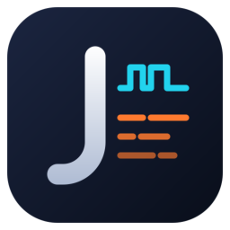

# Haltd

<p align="center">
  
</p>

An STM32 (ARM Cortex-M) J-Link debug backend and VS Code extension built around a resident daemon + DAP + WebSocket architecture—bringing fast large-ELF symbol caching, smooth `-O2` stepping, HardFault decoding, FreeRTOS awareness, 1 kHz live waveform plotting, and structured RTT decoding directly into VS Code.

> **Requirements**: Install the **SEGGER J-Link Software** driver on your machine (`libjlinkarm.so` on Linux / `JLink_x64.dll` on Windows). The `haltd` backend binary is bundled inside the platform-specific extension package (`linux-x64` / `win32-x64`).

## Key Features

- **Source-Level Debugging (`-O2` Friendly)**: DWARF 5 `blake3`-cached symbol loading, inline virtual stack frames, `<optimized out>` reporting, conditional/hit-count breakpoints, logpoints, direct-DWT hardware watchpoints, and one-key **`F6` Build & Reload** (incremental sector flashing + automatic breakpoint/watch rebinding).
- **HardFault Interception & Decoding**: halts on fault entry via `DEMCR` vector catch, decodes `CFSR` / `HFSR` / `MMFAR` / `BFAR` / `AFSR`, and unwinds past `<exception N>` directly to the offending source line.
- **FreeRTOS Task Awareness**: reads TCB and task list layouts directly from DWARF (CM3 / CM4F / CM7) with no hardcoded offsets; displays task states, priorities, stack high-water marks, and per-task call stacks.
- **Live Watch (0–5 Hz)**: read and write global/static variables, structs, and bitfields without halting the CPU, with Ozone-style shortcuts (`Ctrl+G` add to Live Watch, `Ctrl+H` add to Timeline).
- **Timeline Oscilloscope (HSS / Polling / RTT)**: up to 1 kHz HSS sampling (overflow falls back to polling) rendered in an Ozone-inspired multi-track oscilloscope panel unifying HSS and RTT signals, with `S` / `A` / `B` cursors, drag-and-drop track grouping, dark/light/high-contrast themes synced to VS Code, `.hlrec` recording, and CSV/PNG export.
- **RTT Terminal & Auto-Decoding**: interactive channel 0 terminal plus zero-config auto-decoding from ELF struct types and `key=value` text, or custom `.haltd/rtt.yaml` (`text`, `text-regex`, `struct`, `lua`, `systemview`).
- **CMSIS-SVD Peripherals View**: protects registers with read side-effects (`DR` / `RDR` / `RXDR`) from automatic reads, with field-level read-modify-write editing.
- **J-Link Device Selection Assist**: `device` autocomplete, core/Flash/RAM + built-in profile hover info, unknown-device warnings in `launch.json`, and the `Haltd: Select Device` command.
- **C++ Type Visualizers**: built-in Lua rules for `units`, `Eigen`, `std::array` / `tuple` / `optional` / `variant` / `span` / `string_view`, and `etl`, plus custom `.haltd/visualizers.lua`.

## Quick Start

1. Compile your firmware with DWARF debug info (`-g`, works with `-O2`).
2. Add a configuration in `.vscode/launch.json`:

```jsonc
{
  "version": "0.2.0",
  "configurations": [
    {
      "name": "J-Link (Haltd)",
      "type": "haltd",
      "request": "launch",
      "device": "STM32H723VG",
      "interface": "SWD",
      "speed": 4000,
      "elf": "${workspaceFolder}/build/firmware.elf",
      "flash": "changed",
      "runToMain": true,
      "preLaunchTask": "build"
    }
  ]
}
```

3. Connect your J-Link probe and press **`F5`** to start debugging (press **`F6`** to Build & Reload).

## Documentation & Source

- [GitHub Repository](https://github.com/Waterkey3rd/Haltd)
- [User Guide (zh-CN)](https://github.com/Waterkey3rd/Haltd/blob/main/docs/usage.md)
- [Architecture & Design (zh-CN)](https://github.com/Waterkey3rd/Haltd/blob/main/docs/DESIGN.md)
- [J-Link Notes & Measured Behaviors (zh-CN)](https://github.com/Waterkey3rd/Haltd/blob/main/docs/jlink-notes.md)

## License

MIT License for Haltd. At runtime, Haltd dynamically loads the user-installed SEGGER J-Link library, whose use remains subject to SEGGER's own license terms.
